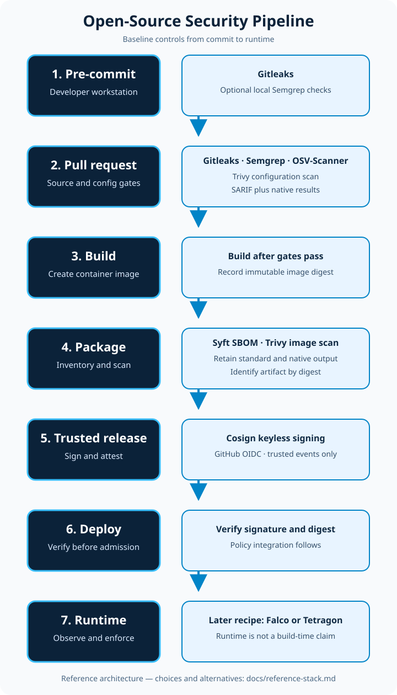

# Awesome Security Pipeline

[](https://awesome.re)
[](http://creativecommons.org/publicdomain/zero/1.0/)
[](https://github.com/rezmoss/awesome-security-pipeline/actions/workflows/security-baseline.yml)

> The practical, continuously verified guide to selecting and implementing open-source security tools at every CI/CD pipeline stage.

<!-- catalog-stats:start -->**78 actively maintained tools · 15 legacy references · status and supply-chain checks refreshed weekly**<!-- catalog-stats:end -->

Start with a working pipeline, not an empty checklist. The included GitHub Actions baseline runs Gitleaks, Semgrep, OSV-Scanner, Trivy, Syft, and keyless Cosign against a safe demo, retains machine-readable evidence, and [passed end to end in 2m21s](https://github.com/rezmoss/awesome-security-pipeline/actions/runs/29529702096) on GitHub-hosted runners.

**Maintenance promise:** repository status is checked weekly, license and documentation evidence monthly, and the tested recipe after every relevant change and at least monthly. Classification rules and exceptions are public in the [methodology](docs/methodology.md).

[**Run the tested pipeline →**](#10-minute-quick-start) · [Choose controls for your project](#choose-your-baseline) · [Browse tools by pipeline stage](#tool-catalog) · [Read the verification methodology](docs/methodology.md)

**[Weekly supply-chain report →](https://rezmoss.github.io/awesome-security-pipeline/)** Every tool in this list is scanned each week at its latest release: dependencies and known vulnerabilities, vulnerable code in the shipped binary, release signature verification, OpenSSF Scorecard, a GitHub Actions workflow audit, and what changed since last week. [Method](benchmarks/supply-chain/README.md).

[](assets/security-pipeline-architecture.svg)

## Start here

| If you want to… | Start with |
|---|---|
| See a complete working implementation | [10-minute quick start](#10-minute-quick-start) |
| Understand the architecture and measured implementation findings | [Technical implementation article](docs/articles/verified-open-source-security-pipeline.md) |
| Understand every job, artifact, permission, and failure mode | [Security demo guide](examples/security-demo/README.md) |
| Review user-visible release changes and verification evidence | [Changelog](CHANGELOG.md) |
| Choose a smaller or more specialized stack | [Project-type selection matrix](#choose-your-baseline) |
| Compare GitHub Actions security tools and permissions | [Open-source stack comparison](comparisons/github-actions-security-tools.md) |
| Choose an SBOM generator and validation workflow | [SBOM tools comparison](comparisons/sbom-tools.md) |
| See every listed tool's dependencies, known vulnerabilities, and week-over-week changes | [Weekly supply-chain report](https://rezmoss.github.io/awesome-security-pipeline/) |
| Evaluate why these tools were selected | [Reference stack decision](docs/reference-stack.md) |
| Check how projects are selected and classified | [Curation and verification methodology](docs/methodology.md) |

## 10-minute quick start

The fastest safe trial is to run the committed demo in a fork. It requires only a GitHub account and GitHub Actions; it requires no cloud account, custom secret, registry, or deployment.

1. Fork this repository and enable GitHub Actions in the fork.
2. Open **Actions → Security Baseline → Run workflow** and select the default branch.
3. Confirm the Secrets, SAST, Dependencies, IaC, Build, and Package jobs pass.
4. Inspect the named scan reports, CycloneDX SBOM, exported image, and immutable digest under **Artifacts**.
5. To test keyless signing, push the unchanged workflow to the fork's default branch or a `v*` tag. Manual and pull-request runs intentionally skip signing.

To adapt the baseline in another repository, copy these paths first, then change the `examples/security-demo/app` scan and build paths to your application:

```text
.github/workflows/security-baseline.yml
.gitleaks.toml
.semgrep/security-baseline.yml
examples/security-demo/        # replace after the first green run
```

The default policy fails on detected secrets, configured high-confidence SAST findings, any published dependency vulnerability, and fixed HIGH/CRITICAL configuration or image findings. SARIF upload requires GitHub code scanning support; all reports remain downloadable workflow artifacts. See the [demo guide](examples/security-demo/README.md) before changing thresholds or permissions.

## Choose your baseline

Use the smallest set that covers the artifacts you actually ship. “Regulated” below is a starting architecture, not a compliance claim.

| Project type | Start with | Add when applicable | Why |
|---|---|---|---|
| Library | Gitleaks, Semgrep, OSV-Scanner | Syft for release SBOMs; Cosign for signed release files | Protect source and dependencies without container-only stages. |
| Web application | Gitleaks, Semgrep, OSV-Scanner | ZAP against a controlled test deployment | Combine source/dependency gates with explicit dynamic testing. |
| Container service | Tested baseline: Gitleaks, Semgrep, OSV-Scanner, Trivy, Syft, Cosign | Runtime detection such as Falco when operating the service | Cover source, image, SBOM, and signed-package risks. |
| Kubernetes service | Container-service baseline | Trivy manifest scanning, Kyverno or Gatekeeper admission policy, runtime detection | Separate build-time evidence from cluster admission and runtime controls. |
| Regulated project | Relevant baseline above with retained SARIF, SBOM, digest, and signature | Organization-specific policy, approvals, provenance, and evidence retention | Produce reviewable evidence while leaving control mapping to the applicable framework. |

## Contents

- [Start here](#start-here)
- [10-minute quick start](#10-minute-quick-start)
- [Choose your baseline](#choose-your-baseline)
<!-- catalog-toc:start -->
- [Tool catalog](#tool-catalog)
- [Pre-commit & Secrets Detection](#pre-commit--secrets-detection)
- [SBOM Generation](#sbom-generation)
- [Artifact Signing & Verification](#artifact-signing--verification)
- [Supply Chain Compliance](#supply-chain-compliance)
- [Software Composition Analysis (SCA)](#software-composition-analysis-sca)
- [Static Application Security Testing (SAST)](#static-application-security-testing-sast)
  - [Multi-language](#multi-language)
  - [Language-specific](#language-specific)
- [Infrastructure as Code Security](#infrastructure-as-code-security)
- [Container Security](#container-security)
  - [Image Scanning](#image-scanning)
  - [Runtime Security](#runtime-security)
- [Kubernetes Security](#kubernetes-security)
- [Policy as Code](#policy-as-code)
- [Secret Management](#secret-management)
- [API & Dynamic Testing (DAST)](#api--dynamic-testing-dast)
- [Cloud Security](#cloud-security)
- [Legacy and Reference Tools](#legacy-and-reference-tools)
<!-- catalog-toc:end -->
- [Contributing](#contributing)
- [License](#license)

---

<!-- catalog:start -->
## Tool catalog

Entries are organized by where they operate in a delivery pipeline. Status reflects repository activity, not security effectiveness; stars indicate adoption, not quality. Multi-purpose tools may appear in more than one category with a category-specific description.

**Status:** 🟢 Active (commit in the last 6 months) · 🟡 Stale (6–12 months) · 🔴 Unmaintained (over 12 months) · ⚪ Archived. Unmaintained and archived tools move to [Legacy](#legacy-and-reference-tools) automatically and return when they are active again. **Scorecard** (OpenSSF, out of 10) and **Release** (whether the Linux release file's signature, provenance, or attestation verifies) come from the [weekly supply-chain report](https://rezmoss.github.io/awesome-security-pipeline/); select a Scorecard value for the tool's full report. Every column is refreshed weekly from each tool's file in [`tools/`](tools/).

## Pre-commit & Secrets Detection

Catch secrets and credentials before they enter your repository.

<table>
<thead><tr><th width="16%" align="left">Tool</th><th width="44%" align="left">What it does</th><th width="15%" align="left">Status</th><th align="right">★</th><th width="12%" align="left">Scorecard</th><th width="13%" align="left">Release</th></tr></thead>
<tbody>
<tr><td align="left"><a href="https://github.com/Yelp/detect-secrets"><b>detect-secrets</b></a></td><td align="left">Prevent secrets from entering codebases</td><td align="left">🟡&nbsp;Stale<br><sub>Apr 2026</sub></td><td align="right">4.7k</td><td align="left"><a href="https://rezmoss.github.io/awesome-security-pipeline/projects/Yelp/detect-secrets/">3.5</a></td><td align="left">—</td></tr>
<tr><td align="left"><a href="https://github.com/gitleaks/gitleaks"><b>gitleaks</b></a></td><td align="left">Detect and prevent secrets in git repos</td><td align="left">🟢&nbsp;Active<br><sub>Oct 2026</sub></td><td align="right">30.6k</td><td align="left"><a href="https://rezmoss.github.io/awesome-security-pipeline/projects/gitleaks/gitleaks/">report</a></td><td align="left">Checksums</td></tr>
<tr><td align="left"><a href="https://github.com/pre-commit/pre-commit"><b>pre-commit</b></a></td><td align="left">Manage multi-language pre-commit hooks</td><td align="left">🟢&nbsp;Active<br><sub>Oct 2026</sub></td><td align="right">15.7k</td><td align="left"><a href="https://rezmoss.github.io/awesome-security-pipeline/projects/pre-commit/pre-commit/">4.5</a></td><td align="left">—</td></tr>
<tr><td align="left"><a href="https://github.com/thoughtworks/talisman"><b>talisman</b></a></td><td align="left">Detect secrets with pre-push and pre-commit hooks</td><td align="left">🟡&nbsp;Stale<br><sub>Nov 2025</sub></td><td align="right">2.1k</td><td align="left"><a href="https://rezmoss.github.io/awesome-security-pipeline/projects/thoughtworks/talisman/">3.3</a></td><td align="left">Checksums</td></tr>
<tr><td align="left"><a href="https://github.com/trufflesecurity/trufflehog"><b>trufflehog</b></a></td><td align="left">Find credentials in git history and live systems</td><td align="left">🟢&nbsp;Active<br><sub>Nov 2026</sub></td><td align="right">28.8k</td><td align="left"><a href="https://rezmoss.github.io/awesome-security-pipeline/projects/trufflesecurity/trufflehog/">7.9</a></td><td align="left">✓&nbsp;Verified</td></tr>
</tbody>
</table>

## SBOM Generation

Generate Software Bill of Materials for supply chain visibility.

<table>
<thead><tr><th width="16%" align="left">Tool</th><th width="44%" align="left">What it does</th><th width="15%" align="left">Status</th><th align="right">★</th><th width="12%" align="left">Scorecard</th><th width="13%" align="left">Release</th></tr></thead>
<tbody>
<tr><td align="left"><a href="https://github.com/CycloneDX/cdxgen"><b>cdxgen</b></a></td><td align="left">Create CycloneDX SBOMs for various languages</td><td align="left">🟢&nbsp;Active<br><sub>Nov 2026</sub></td><td align="right">1.1k</td><td align="left"><a href="https://rezmoss.github.io/awesome-security-pipeline/projects/CycloneDX/cdxgen/">report</a></td><td align="left">Checksums</td></tr>
<tr><td align="left"><a href="https://github.com/CycloneDX/cyclonedx-cli"><b>cyclonedx-cli</b></a></td><td align="left">Inspect, convert, and merge CycloneDX SBOMs</td><td align="left">🟢&nbsp;Active<br><sub>Jul 2026</sub></td><td align="right">552</td><td align="left"><a href="https://rezmoss.github.io/awesome-security-pipeline/projects/CycloneDX/cyclonedx-cli/">report</a></td><td align="left">—</td></tr>
<tr><td align="left"><a href="https://github.com/microsoft/sbom-tool"><b>sbom-tool</b></a></td><td align="left">Generate SBOMs for build artifacts and source repositories</td><td align="left">🟢&nbsp;Active<br><sub>Sep 2026</sub></td><td align="right">2.1k</td><td align="left"><a href="https://rezmoss.github.io/awesome-security-pipeline/projects/microsoft/sbom-tool/">report</a></td><td align="left">—</td></tr>
<tr><td align="left"><a href="https://github.com/rezmoss/sbomlyze"><b>sbomlyze</b></a></td><td align="left">Compare SBOMs to detect supply-chain drift <sub><i>Maintained by this list&#x27;s maintainer.</i></sub></td><td align="left">🟢&nbsp;Active<br><sub>Nov 2026</sub></td><td align="right">26</td><td align="left"><a href="https://rezmoss.github.io/awesome-security-pipeline/projects/rezmoss/sbomlyze/">7.9</a></td><td align="left">✓&nbsp;Verified</td></tr>
<tr><td align="left"><a href="https://github.com/anchore/syft"><b>syft</b></a></td><td align="left">Generate SBOMs from container images and filesystems</td><td align="left">🟢&nbsp;Active<br><sub>Nov 2026</sub></td><td align="right">9.8k</td><td align="left"><a href="https://rezmoss.github.io/awesome-security-pipeline/projects/anchore/syft/">8.7</a></td><td align="left">✓&nbsp;Verified</td></tr>
</tbody>
</table>

## Artifact Signing & Verification

Sign and verify container images and artifacts for supply chain security.

<table>
<thead><tr><th width="16%" align="left">Tool</th><th width="44%" align="left">What it does</th><th width="15%" align="left">Status</th><th align="right">★</th><th width="12%" align="left">Scorecard</th><th width="13%" align="left">Release</th></tr></thead>
<tbody>
<tr><td align="left"><a href="https://github.com/sigstore/cosign"><b>cosign</b></a></td><td align="left">Sign and verify container images</td><td align="left">🟢&nbsp;Active<br><sub>Oct 2026</sub></td><td align="right">6.4k</td><td align="left"><a href="https://rezmoss.github.io/awesome-security-pipeline/projects/sigstore/cosign/">8.2</a></td><td align="left">✓&nbsp;Verified</td></tr>
<tr><td align="left"><a href="https://github.com/notaryproject/notation"><b>notation</b></a></td><td align="left">Sign and verify OCI artifacts with Notary Project specifications</td><td align="left">🟢&nbsp;Active<br><sub>Oct 2026</sub></td><td align="right">502</td><td align="left"><a href="https://rezmoss.github.io/awesome-security-pipeline/projects/notaryproject/notation/">6.5</a></td><td align="left">Checksums</td></tr>
<tr><td align="left"><a href="https://github.com/sigstore/rekor"><b>rekor</b></a></td><td align="left">Record signed artifacts in a tamper-resistant transparency log</td><td align="left">🟢&nbsp;Active<br><sub>Oct 2026</sub></td><td align="right">1.2k</td><td align="left"><a href="https://rezmoss.github.io/awesome-security-pipeline/projects/sigstore/rekor/">8.6</a></td><td align="left">✓&nbsp;Verified</td></tr>
</tbody>
</table>

## Supply Chain Compliance

Audit and verify supply chain security against industry benchmarks.

<table>
<thead><tr><th width="16%" align="left">Tool</th><th width="44%" align="left">What it does</th><th width="15%" align="left">Status</th><th align="right">★</th><th width="12%" align="left">Scorecard</th><th width="13%" align="left">Release</th></tr></thead>
<tbody>
<tr><td align="left"><a href="https://github.com/in-toto/in-toto"><b>in-toto</b></a></td><td align="left">Protect software supply-chain integrity with signed metadata</td><td align="left">🟢&nbsp;Active<br><sub>Aug 2026</sub></td><td align="right">1.1k</td><td align="left"><a href="https://rezmoss.github.io/awesome-security-pipeline/projects/in-toto/in-toto/">6.5</a></td><td align="left">—</td></tr>
<tr><td align="left"><a href="https://github.com/ossf/scorecard"><b>scorecard</b></a></td><td align="left">Measure open-source project security practices with OpenSSF checks</td><td align="left">🟢&nbsp;Active<br><sub>Oct 2026</sub></td><td align="right">5.8k</td><td align="left"><a href="https://rezmoss.github.io/awesome-security-pipeline/projects/ossf/scorecard/">8.6</a></td><td align="left">✓&nbsp;Verified</td></tr>
<tr><td align="left"><a href="https://github.com/slsa-framework/slsa-verifier"><b>slsa-verifier</b></a></td><td align="left">Verify SLSA provenance for supply chain security</td><td align="left">🟢&nbsp;Active<br><sub>Aug 2026</sub></td><td align="right">352</td><td align="left"><a href="https://rezmoss.github.io/awesome-security-pipeline/projects/slsa-framework/slsa-verifier/">report</a></td><td align="left">✓&nbsp;Verified</td></tr>
</tbody>
</table>

## Software Composition Analysis (SCA)

Scan dependencies for known vulnerabilities.

<table>
<thead><tr><th width="16%" align="left">Tool</th><th width="44%" align="left">What it does</th><th width="15%" align="left">Status</th><th align="right">★</th><th width="12%" align="left">Scorecard</th><th width="13%" align="left">Release</th></tr></thead>
<tbody>
<tr><td align="left"><a href="https://github.com/devops-kung-fu/bomber"><b>bomber</b></a></td><td align="left">Scan SBOMs for vulnerabilities</td><td align="left">🟡&nbsp;Stale<br><sub>Feb 2026</sub></td><td align="right">629</td><td align="left"><a href="https://rezmoss.github.io/awesome-security-pipeline/projects/devops-kung-fu/bomber/">report</a></td><td align="left">Checksums</td></tr>
<tr><td align="left"><a href="https://github.com/DependencyTrack/dependency-track"><b>dependency-track</b></a></td><td align="left">Track components and analyze dependency risk from SBOMs</td><td align="left">🟢&nbsp;Active<br><sub>Nov 2026</sub></td><td align="right">4.4k</td><td align="left"><a href="https://rezmoss.github.io/awesome-security-pipeline/projects/DependencyTrack/dependency-track/">7.5</a></td><td align="left">—</td></tr>
<tr><td align="left"><a href="https://github.com/anchore/grype"><b>grype</b></a></td><td align="left">Scan filesystems and SBOMs for dependency vulnerabilities</td><td align="left">🟢&nbsp;Active<br><sub>Oct 2026</sub></td><td align="right">13.2k</td><td align="left"><a href="https://rezmoss.github.io/awesome-security-pipeline/projects/anchore/grype/">7.9</a></td><td align="left">✓&nbsp;Verified</td></tr>
<tr><td align="left"><a href="https://github.com/google/osv-scanner"><b>osv-scanner</b></a></td><td align="left">Scan dependencies for vulnerabilities in the OSV database</td><td align="left">🟢&nbsp;Active<br><sub>Oct 2026</sub></td><td align="right">11.3k</td><td align="left"><a href="https://rezmoss.github.io/awesome-security-pipeline/projects/google/osv-scanner/">8.6</a></td><td align="left">✓&nbsp;Verified</td></tr>
<tr><td align="left"><a href="https://github.com/AikidoSec/safe-chain"><b>safe-chain</b></a></td><td align="left">Block malicious packages during npm/pip install</td><td align="left">🟢&nbsp;Active<br><sub>Oct 2026</sub></td><td align="right">1.8k</td><td align="left"><a href="https://rezmoss.github.io/awesome-security-pipeline/projects/AikidoSec/safe-chain/">4.5</a></td><td align="left">✓&nbsp;Verified</td></tr>
<tr><td align="left"><a href="https://github.com/snyk/cli"><b>snyk-cli</b></a></td><td align="left">Find and fix vulnerabilities in dependencies</td><td align="left">🟢&nbsp;Active<br><sub>Oct 2026</sub></td><td align="right">5.7k</td><td align="left"><a href="https://rezmoss.github.io/awesome-security-pipeline/projects/snyk/cli/">report</a></td><td align="left">Checksums</td></tr>
<tr><td align="left"><a href="https://github.com/aquasecurity/trivy"><b>trivy</b></a></td><td align="left">Scan operating-system and language dependencies for vulnerabilities</td><td align="left">🟢&nbsp;Active<br><sub>Oct 2026</sub></td><td align="right">38.9k</td><td align="left"><a href="https://rezmoss.github.io/awesome-security-pipeline/projects/aquasecurity/trivy/">7.1</a></td><td align="left">✓&nbsp;Verified</td></tr>
<tr><td align="left"><a href="https://github.com/safedep/vet"><b>vet</b></a></td><td align="left">Enforce dependency policies and report supply-chain risks</td><td align="left">🟢&nbsp;Active<br><sub>Nov 2026</sub></td><td align="right">1.1k</td><td align="left"><a href="https://rezmoss.github.io/awesome-security-pipeline/projects/safedep/vet/">7.4</a></td><td align="left">✓&nbsp;Verified</td></tr>
</tbody>
</table>

## Static Application Security Testing (SAST)

Analyze source code for security vulnerabilities.

### Multi-language

Tools that support multiple programming languages.

<table>
<thead><tr><th width="16%" align="left">Tool</th><th width="44%" align="left">What it does</th><th width="15%" align="left">Status</th><th align="right">★</th><th width="12%" align="left">Scorecard</th><th width="13%" align="left">Release</th></tr></thead>
<tbody>
<tr><td align="left"><a href="https://github.com/Bearer/bearer"><b>bearer</b></a></td><td align="left">Trace sensitive data flows and detect security risks in code</td><td align="left">🟢&nbsp;Active<br><sub>Oct 2026</sub></td><td align="right">2.8k</td><td align="left"><a href="https://rezmoss.github.io/awesome-security-pipeline/projects/Bearer/bearer/">6.3</a></td><td align="left">Checksums</td></tr>
<tr><td align="left"><a href="https://github.com/github/codeql"><b>codeql</b></a></td><td align="left">Analyze code semantically with GitHub&#x27;s query engine</td><td align="left">🟢&nbsp;Active<br><sub>Oct 2026</sub></td><td align="right">10.3k</td><td align="left"><a href="https://rezmoss.github.io/awesome-security-pipeline/projects/github/codeql/">5.8</a></td><td align="left">—</td></tr>
<tr><td align="left"><a href="https://github.com/semgrep/semgrep"><b>semgrep</b></a></td><td align="left">Scan source code with multi-language static-analysis rules</td><td align="left">🟢&nbsp;Active<br><sub>Oct 2026</sub></td><td align="right">17.4k</td><td align="left"><a href="https://rezmoss.github.io/awesome-security-pipeline/projects/semgrep/semgrep/">report</a></td><td align="left">—</td></tr>
<tr><td align="left"><a href="https://github.com/SonarSource/sonarqube"><b>sonarqube</b></a></td><td align="left">Inspect code continuously for quality and security issues</td><td align="left">🟢&nbsp;Active<br><sub>Oct 2026</sub></td><td align="right">11.1k</td><td align="left"><a href="https://rezmoss.github.io/awesome-security-pipeline/projects/SonarSource/sonarqube/">4.9</a></td><td align="left">—</td></tr>
<tr><td align="left"><a href="https://github.com/spotbugs/spotbugs"><b>spotbugs</b></a></td><td align="left">Find bug patterns in Java bytecode</td><td align="left">🟢&nbsp;Active<br><sub>Nov 2026</sub></td><td align="right">4k</td><td align="left"><a href="https://rezmoss.github.io/awesome-security-pipeline/projects/spotbugs/spotbugs/">4.6</a></td><td align="left">—</td></tr>
</tbody>
</table>

### Language-specific

Specialized tools for individual programming languages.

#### Python

<table>
<thead><tr><th width="16%" align="left">Tool</th><th width="44%" align="left">What it does</th><th width="15%" align="left">Status</th><th align="right">★</th><th width="12%" align="left">Scorecard</th><th width="13%" align="left">Release</th></tr></thead>
<tbody>
<tr><td align="left"><a href="https://github.com/PyCQA/bandit"><b>bandit</b></a></td><td align="left">Find common security issues in Python code</td><td align="left">🟢&nbsp;Active<br><sub>Oct 2026</sub></td><td align="right">8.4k</td><td align="left"><a href="https://rezmoss.github.io/awesome-security-pipeline/projects/PyCQA/bandit/">5.8</a></td><td align="left">—</td></tr>
<tr><td align="left"><a href="https://github.com/pyupio/safety"><b>safety</b></a></td><td align="left">Check Python dependencies for vulnerabilities</td><td align="left">🟢&nbsp;Active<br><sub>Sep 2026</sub></td><td align="right">2k</td><td align="left"><a href="https://rezmoss.github.io/awesome-security-pipeline/projects/pyupio/safety/">4.7</a></td><td align="left">—</td></tr>
</tbody>
</table>

#### JavaScript/Node.js

<table>
<thead><tr><th width="16%" align="left">Tool</th><th width="44%" align="left">What it does</th><th width="15%" align="left">Status</th><th align="right">★</th><th width="12%" align="left">Scorecard</th><th width="13%" align="left">Release</th></tr></thead>
<tbody>
<tr><td align="left"><a href="https://github.com/eslint-community/eslint-plugin-security"><b>eslint-plugin-security</b></a></td><td align="left">Detect security patterns in Node.js with ESLint rules</td><td align="left">🟢&nbsp;Active<br><sub>Oct 2026</sub></td><td align="right">2.4k</td><td align="left"><a href="https://rezmoss.github.io/awesome-security-pipeline/projects/eslint-community/eslint-plugin-security/">report</a></td><td align="left">—</td></tr>
<tr><td align="left"><a href="https://github.com/ajinabraham/njsscan"><b>njsscan</b></a></td><td align="left">Analyze Node.js applications with semantic SAST rules</td><td align="left">🟢&nbsp;Active<br><sub>Oct 2026</sub></td><td align="right">458</td><td align="left"><a href="https://rezmoss.github.io/awesome-security-pipeline/projects/ajinabraham/njsscan/">5.5</a></td><td align="left">—</td></tr>
</tbody>
</table>

#### Go

<table>
<thead><tr><th width="16%" align="left">Tool</th><th width="44%" align="left">What it does</th><th width="15%" align="left">Status</th><th align="right">★</th><th width="12%" align="left">Scorecard</th><th width="13%" align="left">Release</th></tr></thead>
<tbody>
<tr><td align="left"><a href="https://github.com/securego/gosec"><b>gosec</b></a></td><td align="left">Find security issues in Go source code</td><td align="left">🟢&nbsp;Active<br><sub>Oct 2026</sub></td><td align="right">9k</td><td align="left"><a href="https://rezmoss.github.io/awesome-security-pipeline/projects/securego/gosec/">6.6</a></td><td align="left">✓&nbsp;Verified</td></tr>
<tr><td align="left"><a href="https://github.com/golang/vuln"><b>govulncheck</b></a></td><td align="left">Report reachable Go vulnerabilities in source and binaries</td><td align="left">🟢&nbsp;Active<br><sub>Oct 2026</sub></td><td align="right">532</td><td align="left"><a href="https://rezmoss.github.io/awesome-security-pipeline/projects/golang/vuln/">3.7</a></td><td align="left">—</td></tr>
</tbody>
</table>

#### Ruby

<table>
<thead><tr><th width="16%" align="left">Tool</th><th width="44%" align="left">What it does</th><th width="15%" align="left">Status</th><th align="right">★</th><th width="12%" align="left">Scorecard</th><th width="13%" align="left">Release</th></tr></thead>
<tbody>
<tr><td align="left"><a href="https://github.com/presidentbeef/brakeman"><b>brakeman</b></a></td><td align="left">Scan Ruby on Rails applications with static analysis</td><td align="left">🟢&nbsp;Active<br><sub>Oct 2026</sub></td><td align="right">7.3k</td><td align="left"><a href="https://rezmoss.github.io/awesome-security-pipeline/projects/presidentbeef/brakeman/">6.0</a></td><td align="left">—</td></tr>
</tbody>
</table>

#### PHP

<table>
<thead><tr><th width="16%" align="left">Tool</th><th width="44%" align="left">What it does</th><th width="15%" align="left">Status</th><th align="right">★</th><th width="12%" align="left">Scorecard</th><th width="13%" align="left">Release</th></tr></thead>
<tbody>
<tr><td align="left"><a href="https://github.com/phpstan/phpstan"><b>phpstan</b></a></td><td align="left">Analyze PHP code without running it</td><td align="left">🟢&nbsp;Active<br><sub>Nov 2026</sub></td><td align="right">14.1k</td><td align="left"><a href="https://rezmoss.github.io/awesome-security-pipeline/projects/phpstan/phpstan/">4.8</a></td><td align="left">—</td></tr>
<tr><td align="left"><a href="https://github.com/vimeo/psalm"><b>psalm</b></a></td><td align="left">Analyze PHP code for type and security issues</td><td align="left">🟢&nbsp;Active<br><sub>Nov 2026</sub></td><td align="right">5.9k</td><td align="left"><a href="https://rezmoss.github.io/awesome-security-pipeline/projects/vimeo/psalm/">4.7</a></td><td align="left">—</td></tr>
</tbody>
</table>

#### Rust

<table>
<thead><tr><th width="16%" align="left">Tool</th><th width="44%" align="left">What it does</th><th width="15%" align="left">Status</th><th align="right">★</th><th width="12%" align="left">Scorecard</th><th width="13%" align="left">Release</th></tr></thead>
<tbody>
<tr><td align="left"><a href="https://github.com/RustSec/rustsec"><b>cargo-audit</b></a></td><td align="left">Audit Cargo.lock for crates with security vulnerabilities</td><td align="left">🟢&nbsp;Active<br><sub>Oct 2026</sub></td><td align="right">2k</td><td align="left"><a href="https://rezmoss.github.io/awesome-security-pipeline/projects/RustSec/rustsec/">report</a></td><td align="left">—</td></tr>
</tbody>
</table>

## Infrastructure as Code Security

Scan infrastructure configurations for security misconfigurations.

<table>
<thead><tr><th width="16%" align="left">Tool</th><th width="44%" align="left">What it does</th><th width="15%" align="left">Status</th><th align="right">★</th><th width="12%" align="left">Scorecard</th><th width="13%" align="left">Release</th></tr></thead>
<tbody>
<tr><td align="left"><a href="https://github.com/aws-cloudformation/cfn-lint"><b>cfn-lint</b></a></td><td align="left">Lint AWS CloudFormation templates with security rules</td><td align="left">🟢&nbsp;Active<br><sub>Oct 2026</sub></td><td align="right">2.6k</td><td align="left"><a href="https://rezmoss.github.io/awesome-security-pipeline/projects/aws-cloudformation/cfn-lint/">6.0</a></td><td align="left">—</td></tr>
<tr><td align="left"><a href="https://github.com/bridgecrewio/checkov"><b>checkov</b></a></td><td align="left">Scan cloud infrastructure configurations</td><td align="left">🟢&nbsp;Active<br><sub>Oct 2026</sub></td><td align="right">9.1k</td><td align="left"><a href="https://rezmoss.github.io/awesome-security-pipeline/projects/bridgecrewio/checkov/">report</a></td><td align="left">—</td></tr>
<tr><td align="left"><a href="https://github.com/Checkmarx/kics"><b>kics</b></a></td><td align="left">Find security vulnerabilities and compliance issues in IaC</td><td align="left">🟢&nbsp;Active<br><sub>Oct 2026</sub></td><td align="right">2.7k</td><td align="left"><a href="https://rezmoss.github.io/awesome-security-pipeline/projects/Checkmarx/kics/">report</a></td><td align="left">—</td></tr>
<tr><td align="left"><a href="https://github.com/snyk/cli"><b>snyk-cli</b></a></td><td align="left">Scan infrastructure as code for security issues</td><td align="left">🟢&nbsp;Active<br><sub>Oct 2026</sub></td><td align="right">5.7k</td><td align="left"><a href="https://rezmoss.github.io/awesome-security-pipeline/projects/snyk/cli/">report</a></td><td align="left">Checksums</td></tr>
<tr><td align="left"><a href="https://github.com/aquasecurity/trivy"><b>trivy</b></a></td><td align="left">Scan Terraform, CloudFormation, and other IaC for misconfigurations</td><td align="left">🟢&nbsp;Active<br><sub>Oct 2026</sub></td><td align="right">38.9k</td><td align="left"><a href="https://rezmoss.github.io/awesome-security-pipeline/projects/aquasecurity/trivy/">7.1</a></td><td align="left">✓&nbsp;Verified</td></tr>
<tr><td align="left"><a href="https://github.com/zizmorcore/zizmor"><b>zizmor</b></a></td><td align="left">Analyze GitHub Actions workflows for security issues</td><td align="left">🟢&nbsp;Active<br><sub>Oct 2026</sub></td><td align="right">6.9k</td><td align="left"><a href="https://rezmoss.github.io/awesome-security-pipeline/projects/zizmorcore/zizmor/">report</a></td><td align="left">✓&nbsp;Verified</td></tr>
</tbody>
</table>

## Container Security

Secure container images and runtime environments.

### Image Scanning

Scan container images for vulnerabilities before deployment.

<table>
<thead><tr><th width="16%" align="left">Tool</th><th width="44%" align="left">What it does</th><th width="15%" align="left">Status</th><th align="right">★</th><th width="12%" align="left">Scorecard</th><th width="13%" align="left">Release</th></tr></thead>
<tbody>
<tr><td align="left"><a href="https://github.com/quay/clair"><b>clair</b></a></td><td align="left">Analyze container images for known vulnerabilities</td><td align="left">🟢&nbsp;Active<br><sub>Oct 2026</sub></td><td align="right">11.1k</td><td align="left"><a href="https://rezmoss.github.io/awesome-security-pipeline/projects/quay/clair/">5.0</a></td><td align="left">—</td></tr>
<tr><td align="left"><a href="https://github.com/wagoodman/dive"><b>dive</b></a></td><td align="left">Inspect image layers and contents; it does not scan vulnerability databases</td><td align="left">🟢&nbsp;Active<br><sub>Oct 2026</sub></td><td align="right">54.7k</td><td align="left"><a href="https://rezmoss.github.io/awesome-security-pipeline/projects/wagoodman/dive/">3.4</a></td><td align="left">Checksums</td></tr>
<tr><td align="left"><a href="https://github.com/docker/docker-bench-security"><b>docker-bench-security</b></a></td><td align="left">Check Docker deployment against CIS benchmarks</td><td align="left">🟢&nbsp;Active<br><sub>Jun 2026</sub></td><td align="right">9.7k</td><td align="left"><a href="https://rezmoss.github.io/awesome-security-pipeline/projects/docker/docker-bench-security/">6.7</a></td><td align="left">—</td></tr>
<tr><td align="left"><a href="https://github.com/goodwithtech/dockle"><b>dockle</b></a></td><td align="left">Lint container images for security best practices</td><td align="left">🟢&nbsp;Active<br><sub>Jul 2026</sub></td><td align="right">3.3k</td><td align="left"><a href="https://rezmoss.github.io/awesome-security-pipeline/projects/goodwithtech/dockle/">4.1</a></td><td align="left">Checksums</td></tr>
<tr><td align="left"><a href="https://github.com/anchore/grype"><b>grype</b></a></td><td align="left">Scan container images for operating-system and library vulnerabilities</td><td align="left">🟢&nbsp;Active<br><sub>Oct 2026</sub></td><td align="right">13.2k</td><td align="left"><a href="https://rezmoss.github.io/awesome-security-pipeline/projects/anchore/grype/">7.9</a></td><td align="left">✓&nbsp;Verified</td></tr>
<tr><td align="left"><a href="https://github.com/hadolint/hadolint"><b>hadolint</b></a></td><td align="left">Lint Dockerfiles for security and build best practices</td><td align="left">🟢&nbsp;Active<br><sub>Oct 2026</sub></td><td align="right">12.5k</td><td align="left"><a href="https://rezmoss.github.io/awesome-security-pipeline/projects/hadolint/hadolint/">4.7</a></td><td align="left">✓&nbsp;Verified</td></tr>
<tr><td align="left"><a href="https://github.com/aquasecurity/trivy"><b>trivy</b></a></td><td align="left">Scan container images for operating-system and library vulnerabilities</td><td align="left">🟢&nbsp;Active<br><sub>Oct 2026</sub></td><td align="right">38.9k</td><td align="left"><a href="https://rezmoss.github.io/awesome-security-pipeline/projects/aquasecurity/trivy/">7.1</a></td><td align="left">✓&nbsp;Verified</td></tr>
</tbody>
</table>

### Runtime Security

Monitor and protect containers at runtime.

<table>
<thead><tr><th width="16%" align="left">Tool</th><th width="44%" align="left">What it does</th><th width="15%" align="left">Status</th><th align="right">★</th><th width="12%" align="left">Scorecard</th><th width="13%" align="left">Release</th></tr></thead>
<tbody>
<tr><td align="left"><a href="https://github.com/falcosecurity/falco"><b>falco</b></a></td><td align="left">Detect runtime threats in cloud-native environments</td><td align="left">🟢&nbsp;Active<br><sub>Oct 2026</sub></td><td align="right">9.5k</td><td align="left"><a href="https://rezmoss.github.io/awesome-security-pipeline/projects/falcosecurity/falco/">7.5</a></td><td align="left">—</td></tr>
<tr><td align="left"><a href="https://github.com/draios/sysdig-inspect"><b>sysdig-inspect</b></a></td><td align="left">Visualize system calls and analyze containers</td><td align="left">🟢&nbsp;Active<br><sub>Jul 2026</sub></td><td align="right">1k</td><td align="left"><a href="https://rezmoss.github.io/awesome-security-pipeline/projects/draios/sysdig-inspect/">report</a></td><td align="left">—</td></tr>
<tr><td align="left"><a href="https://github.com/cilium/tetragon"><b>tetragon</b></a></td><td align="left">Observe and enforce runtime security with eBPF</td><td align="left">🟢&nbsp;Active<br><sub>Oct 2026</sub></td><td align="right">5.1k</td><td align="left"><a href="https://rezmoss.github.io/awesome-security-pipeline/projects/cilium/tetragon/">report</a></td><td align="left">—</td></tr>
<tr><td align="left"><a href="https://github.com/aquasecurity/tracee"><b>tracee</b></a></td><td align="left">Trace Linux runtime activity and security events with eBPF</td><td align="left">🟢&nbsp;Active<br><sub>Sep 2026</sub></td><td align="right">4.7k</td><td align="left"><a href="https://rezmoss.github.io/awesome-security-pipeline/projects/aquasecurity/tracee/">7.0</a></td><td align="left">Checksums</td></tr>
</tbody>
</table>

## Kubernetes Security

Secure Kubernetes clusters, manifests, and workloads.

<table>
<thead><tr><th width="16%" align="left">Tool</th><th width="44%" align="left">What it does</th><th width="15%" align="left">Status</th><th align="right">★</th><th width="12%" align="left">Scorecard</th><th width="13%" align="left">Release</th></tr></thead>
<tbody>
<tr><td align="left"><a href="https://github.com/aquasecurity/kube-bench"><b>kube-bench</b></a></td><td align="left">Check Kubernetes against CIS benchmarks</td><td align="left">🟢&nbsp;Active<br><sub>Oct 2026</sub></td><td align="right">8.2k</td><td align="left"><a href="https://rezmoss.github.io/awesome-security-pipeline/projects/aquasecurity/kube-bench/">5.8</a></td><td align="left">Checksums</td></tr>
<tr><td align="left"><a href="https://github.com/stackrox/kube-linter"><b>kube-linter</b></a></td><td align="left">Analyze Kubernetes YAML and Helm charts before deployment</td><td align="left">🟢&nbsp;Active<br><sub>Oct 2026</sub></td><td align="right">3.5k</td><td align="left"><a href="https://rezmoss.github.io/awesome-security-pipeline/projects/stackrox/kube-linter/">7.4</a></td><td align="left">Signed</td></tr>
<tr><td align="left"><a href="https://github.com/kubescape/kubescape"><b>kubescape</b></a></td><td align="left">Analyze Kubernetes security risk and configuration compliance</td><td align="left">🟢&nbsp;Active<br><sub>Oct 2026</sub></td><td align="right">11.8k</td><td align="left"><a href="https://rezmoss.github.io/awesome-security-pipeline/projects/kubescape/kubescape/">7.6</a></td><td align="left">✓&nbsp;Verified</td></tr>
<tr><td align="left"><a href="https://github.com/kubestellar/console"><b>KubeStellar Console</b></a></td><td align="left">View security signals across multiple Kubernetes clusters</td><td align="left">🟢&nbsp;Active<br><sub>Nov 2026</sub></td><td align="right">152</td><td align="left"><a href="https://rezmoss.github.io/awesome-security-pipeline/projects/kubestellar/console/">report</a></td><td align="left">✓&nbsp;Verified</td></tr>
<tr><td align="left"><a href="https://github.com/kyverno/kyverno"><b>kyverno</b></a></td><td align="left">Enforce policies with Kubernetes-native resources</td><td align="left">🟢&nbsp;Active<br><sub>Nov 2026</sub></td><td align="right">8.3k</td><td align="left"><a href="https://rezmoss.github.io/awesome-security-pipeline/projects/kyverno/kyverno/">7.8</a></td><td align="left">✓&nbsp;Verified</td></tr>
<tr><td align="left"><a href="https://github.com/FairwindsOps/polaris"><b>polaris</b></a></td><td align="left">Validate Kubernetes best practices and policies</td><td align="left">🟢&nbsp;Active<br><sub>Oct 2026</sub></td><td align="right">3.4k</td><td align="left"><a href="https://rezmoss.github.io/awesome-security-pipeline/projects/FairwindsOps/polaris/">5.1</a></td><td align="left">Signed</td></tr>
<tr><td align="left"><a href="https://github.com/aquasecurity/trivy-operator"><b>trivy-operator</b></a></td><td align="left">Generate Kubernetes-native security reports</td><td align="left">🟢&nbsp;Active<br><sub>Oct 2026</sub></td><td align="right">2k</td><td align="left"><a href="https://rezmoss.github.io/awesome-security-pipeline/projects/aquasecurity/trivy-operator/">7.5</a></td><td align="left">✓&nbsp;Verified</td></tr>
</tbody>
</table>

## Policy as Code

Define and enforce security policies as code across your infrastructure.

<table>
<thead><tr><th width="16%" align="left">Tool</th><th width="44%" align="left">What it does</th><th width="15%" align="left">Status</th><th align="right">★</th><th width="12%" align="left">Scorecard</th><th width="13%" align="left">Release</th></tr></thead>
<tbody>
<tr><td align="left"><a href="https://github.com/open-policy-agent/conftest"><b>conftest</b></a></td><td align="left">Test configuration files against OPA policies</td><td align="left">🟢&nbsp;Active<br><sub>Oct 2026</sub></td><td align="right">3.3k</td><td align="left"><a href="https://rezmoss.github.io/awesome-security-pipeline/projects/open-policy-agent/conftest/">7.2</a></td><td align="left">✓&nbsp;Verified</td></tr>
<tr><td align="left"><a href="https://github.com/open-policy-agent/gatekeeper"><b>gatekeeper</b></a></td><td align="left">Enforce OPA policies through Kubernetes admission control</td><td align="left">🟢&nbsp;Active<br><sub>Oct 2026</sub></td><td align="right">4.3k</td><td align="left"><a href="https://rezmoss.github.io/awesome-security-pipeline/projects/open-policy-agent/gatekeeper/">report</a></td><td align="left">✓&nbsp;Verified</td></tr>
<tr><td align="left"><a href="https://github.com/open-policy-agent/opa"><b>opa</b></a></td><td align="left">Evaluate policy as code across application and infrastructure systems</td><td align="left">🟢&nbsp;Active<br><sub>Nov 2026</sub></td><td align="right">12.4k</td><td align="left"><a href="https://rezmoss.github.io/awesome-security-pipeline/projects/open-policy-agent/opa/">8.2</a></td><td align="left">✓&nbsp;Verified</td></tr>
</tbody>
</table>

## Secret Management

Securely manage and distribute secrets in Kubernetes and GitOps workflows.

<table>
<thead><tr><th width="16%" align="left">Tool</th><th width="44%" align="left">What it does</th><th width="15%" align="left">Status</th><th align="right">★</th><th width="12%" align="left">Scorecard</th><th width="13%" align="left">Release</th></tr></thead>
<tbody>
<tr><td align="left"><a href="https://github.com/external-secrets/external-secrets"><b>external-secrets</b></a></td><td align="left">Sync secrets from AWS/Vault/Azure into Kubernetes</td><td align="left">🟢&nbsp;Active<br><sub>Oct 2026</sub></td><td align="right">6.9k</td><td align="left"><a href="https://rezmoss.github.io/awesome-security-pipeline/projects/external-secrets/external-secrets/">8.3</a></td><td align="left">—</td></tr>
<tr><td align="left"><a href="https://github.com/Infisical/infisical"><b>infisical</b></a></td><td align="left">Manage application secrets with automation integrations</td><td align="left">🟢&nbsp;Active<br><sub>Nov 2026</sub></td><td align="right">30.2k</td><td align="left"><a href="https://rezmoss.github.io/awesome-security-pipeline/projects/Infisical/infisical/">6.9</a></td><td align="left">—</td></tr>
<tr><td align="left"><a href="https://github.com/bitnami-labs/sealed-secrets"><b>sealed-secrets</b></a></td><td align="left">Encrypt secrets locally, decrypt only in cluster</td><td align="left">🟢&nbsp;Active<br><sub>Oct 2026</sub></td><td align="right">9.3k</td><td align="left"><a href="https://rezmoss.github.io/awesome-security-pipeline/projects/bitnami-labs/sealed-secrets/">6.8</a></td><td align="left">Signed</td></tr>
<tr><td align="left"><a href="https://github.com/getsops/sops"><b>sops</b></a></td><td align="left">Encrypt structured files while preserving editor workflows</td><td align="left">🟢&nbsp;Active<br><sub>Oct 2026</sub></td><td align="right">23.6k</td><td align="left"><a href="https://rezmoss.github.io/awesome-security-pipeline/projects/getsops/sops/">report</a></td><td align="left">✓&nbsp;Verified</td></tr>
<tr><td align="left"><a href="https://github.com/hashicorp/vault"><b>vault</b></a></td><td align="left">Manage secrets, encryption, and privileged access</td><td align="left">🟢&nbsp;Active<br><sub>Oct 2026</sub></td><td align="right">36.5k</td><td align="left"><a href="https://rezmoss.github.io/awesome-security-pipeline/projects/hashicorp/vault/">6.5</a></td><td align="left">—</td></tr>
</tbody>
</table>

## API & Dynamic Testing (DAST)

Test running applications for vulnerabilities.

<table>
<thead><tr><th width="16%" align="left">Tool</th><th width="44%" align="left">What it does</th><th width="15%" align="left">Status</th><th align="right">★</th><th width="12%" align="left">Scorecard</th><th width="13%" align="left">Release</th></tr></thead>
<tbody>
<tr><td align="left"><a href="https://github.com/ASCIT31/Dark-Moon"><b>Dark-Moon</b></a></td><td align="left">Autonomous AI penetration testing platform that exercises running web, API, Active Directory and Kubernetes targets with proof of exploitation</td><td align="left">🟢&nbsp;Active<br><sub>Oct 2026</sub></td><td align="right">1.2k</td><td align="left"><a href="https://rezmoss.github.io/awesome-security-pipeline/projects/ASCIT31/Dark-Moon/">3.8</a></td><td align="left">—</td></tr>
<tr><td align="left"><a href="https://github.com/sullo/nikto"><b>nikto</b></a></td><td align="left">Scan web servers for dangerous files and known vulnerabilities</td><td align="left">🟢&nbsp;Active<br><sub>Aug 2026</sub></td><td align="right">10.8k</td><td align="left"><a href="https://rezmoss.github.io/awesome-security-pipeline/projects/sullo/nikto/">3.8</a></td><td align="left">—</td></tr>
<tr><td align="left"><a href="https://github.com/projectdiscovery/nuclei"><b>nuclei</b></a></td><td align="left">Scan applications and infrastructure with customizable templates</td><td align="left">🟢&nbsp;Active<br><sub>Oct 2026</sub></td><td align="right">32.5k</td><td align="left"><a href="https://rezmoss.github.io/awesome-security-pipeline/projects/projectdiscovery/nuclei/">6.8</a></td><td align="left">Checksums</td></tr>
<tr><td align="left"><a href="https://github.com/sqlmapproject/sqlmap"><b>sqlmap</b></a></td><td align="left">Detect and validate SQL injection vulnerabilities</td><td align="left">🟢&nbsp;Active<br><sub>Oct 2026</sub></td><td align="right">38.8k</td><td align="left"><a href="https://rezmoss.github.io/awesome-security-pipeline/projects/sqlmapproject/sqlmap/">4.9</a></td><td align="left">—</td></tr>
<tr><td align="left"><a href="https://github.com/wapiti-scanner/wapiti"><b>wapiti</b></a></td><td align="left">Scan web applications for vulnerabilities with black-box testing</td><td align="left">🟢&nbsp;Active<br><sub>Oct 2026</sub></td><td align="right">1.9k</td><td align="left"><a href="https://rezmoss.github.io/awesome-security-pipeline/projects/wapiti-scanner/wapiti/">report</a></td><td align="left">—</td></tr>
<tr><td align="left"><a href="https://github.com/zaproxy/zaproxy"><b>zap</b></a></td><td align="left">Scan web applications dynamically with OWASP ZAP</td><td align="left">🟢&nbsp;Active<br><sub>Nov 2026</sub></td><td align="right">16.1k</td><td align="left"><a href="https://rezmoss.github.io/awesome-security-pipeline/projects/zaproxy/zaproxy/">6.8</a></td><td align="left">—</td></tr>
</tbody>
</table>

## Cloud Security

Assess and audit cloud infrastructure security posture.

<table>
<thead><tr><th width="16%" align="left">Tool</th><th width="44%" align="left">What it does</th><th width="15%" align="left">Status</th><th align="right">★</th><th width="12%" align="left">Scorecard</th><th width="13%" align="left">Release</th></tr></thead>
<tbody>
<tr><td align="left"><a href="https://github.com/lyft/cartography"><b>cartography</b></a></td><td align="left">Map infrastructure relationships and attack surface</td><td align="left">🟢&nbsp;Active<br><sub>Nov 2026</sub></td><td align="right">4.2k</td><td align="left"><a href="https://rezmoss.github.io/awesome-security-pipeline/projects/lyft/cartography/">8.1</a></td><td align="left">—</td></tr>
<tr><td align="left"><a href="https://github.com/cloudquery/cloudquery"><b>cloudquery</b></a></td><td align="left">Inventory cloud assets and analyze them with SQL</td><td align="left">🟢&nbsp;Active<br><sub>Nov 2026</sub></td><td align="right">6.6k</td><td align="left"><a href="https://rezmoss.github.io/awesome-security-pipeline/projects/cloudquery/cloudquery/">6.0</a></td><td align="left">Checksums</td></tr>
<tr><td align="left"><a href="https://github.com/salesforce/cloudsplaining"><b>cloudsplaining</b></a></td><td align="left">Assess AWS IAM policies for risky permissions</td><td align="left">🟢&nbsp;Active<br><sub>Oct 2026</sub></td><td align="right">2.3k</td><td align="left"><a href="https://rezmoss.github.io/awesome-security-pipeline/projects/salesforce/cloudsplaining/">5.7</a></td><td align="left">—</td></tr>
<tr><td align="left"><a href="https://github.com/prowler-cloud/prowler"><b>prowler</b></a></td><td align="left">Assess AWS, Azure, and GCP security configurations</td><td align="left">🟢&nbsp;Active<br><sub>Oct 2026</sub></td><td align="right">15.2k</td><td align="left"><a href="https://rezmoss.github.io/awesome-security-pipeline/projects/prowler-cloud/prowler/">report</a></td><td align="left">—</td></tr>
<tr><td align="left"><a href="https://github.com/turbot/steampipe"><b>steampipe</b></a></td><td align="left">Query cloud resources using SQL</td><td align="left">🟢&nbsp;Active<br><sub>Nov 2026</sub></td><td align="right">8k</td><td align="left"><a href="https://rezmoss.github.io/awesome-security-pipeline/projects/turbot/steampipe/">6.8</a></td><td align="left">✓&nbsp;Verified</td></tr>
</tbody>
</table>

## Legacy and Reference Tools

These projects are kept for migration research and historical context, not recommended for new adoption. They are listed here because their repositories are archived or have had no commit for over 12 months. Prefer the alternative noted beside an entry or a maintained tool from the matching category above.

### Pre-commit & Secrets Detection

<table>
<thead><tr><th width="16%" align="left">Tool</th><th width="42%" align="left">What it did</th><th width="17%" align="left">Status</th><th align="right">★</th><th width="25%" align="left">Use instead</th></tr></thead>
<tbody>
<tr><td align="left"><a href="https://github.com/awslabs/git-secrets"><b>git-secrets</b></a></td><td align="left">Prevent committing AWS credentials and secrets</td><td align="left">🔴&nbsp;Unmaintained<br><sub>Sep 2025</sub></td><td align="right">13.4k</td><td align="left">—</td></tr>
<tr><td align="left"><a href="https://github.com/Skyscanner/whispers"><b>whispers</b></a></td><td align="left">Identify hardcoded secrets in static code analysis</td><td align="left">⚪&nbsp;Archived<br><sub>Oct 2021</sub></td><td align="right">506</td><td align="left">—</td></tr>
</tbody>
</table>

### SBOM Generation

<table>
<thead><tr><th width="16%" align="left">Tool</th><th width="42%" align="left">What it did</th><th width="17%" align="left">Status</th><th align="right">★</th><th width="25%" align="left">Use instead</th></tr></thead>
<tbody>
<tr><td align="left"><a href="https://github.com/opensbom-generator/spdx-sbom-generator"><b>spdx-sbom-generator</b></a></td><td align="left">Generate SPDX format SBOMs from source code</td><td align="left">⚪&nbsp;Archived<br><sub>Jan 2025</sub></td><td align="right">427</td><td align="left">—</td></tr>
<tr><td align="left"><a href="https://github.com/tern-tools/tern"><b>tern</b></a></td><td align="left">Analyze container images for software composition</td><td align="left">🔴&nbsp;Unmaintained<br><sub>Dec 2023</sub></td><td align="right">1k</td><td align="left">—</td></tr>
</tbody>
</table>

### Supply Chain Compliance

<table>
<thead><tr><th width="16%" align="left">Tool</th><th width="42%" align="left">What it did</th><th width="17%" align="left">Status</th><th align="right">★</th><th width="25%" align="left">Use instead</th></tr></thead>
<tbody>
<tr><td align="left"><a href="https://github.com/aquasecurity/chain-bench"><b>chain-bench</b></a></td><td align="left">Audit supply chain against CIS benchmarks</td><td align="left">🔴&nbsp;Unmaintained<br><sub>Jul 2024</sub></td><td align="right">772</td><td align="left">—</td></tr>
</tbody>
</table>

### Static Application Security Testing (SAST) › Multi-language

<table>
<thead><tr><th width="16%" align="left">Tool</th><th width="42%" align="left">What it did</th><th width="17%" align="left">Status</th><th align="right">★</th><th width="25%" align="left">Use instead</th></tr></thead>
<tbody>
<tr><td align="left"><a href="https://github.com/ZupIT/horusec"><b>horusec</b></a></td><td align="left">Analyze source code across multiple languages</td><td align="left">🔴&nbsp;Unmaintained<br><sub>Aug 2023</sub></td><td align="right">1.3k</td><td align="left">—</td></tr>
</tbody>
</table>

### Static Application Security Testing (SAST) › Language-specific › Python

<table>
<thead><tr><th width="16%" align="left">Tool</th><th width="42%" align="left">What it did</th><th width="17%" align="left">Status</th><th align="right">★</th><th width="25%" align="left">Use instead</th></tr></thead>
<tbody>
<tr><td align="left"><a href="https://github.com/facebook/pyre-check"><b>pyre-check</b></a></td><td align="left">Analyze Python types and selected security properties</td><td align="left">⚪&nbsp;Archived<br><sub>Jun 2026</sub></td><td align="right">7.2k</td><td align="left">—</td></tr>
</tbody>
</table>

### Infrastructure as Code Security

<table>
<thead><tr><th width="16%" align="left">Tool</th><th width="42%" align="left">What it did</th><th width="17%" align="left">Status</th><th align="right">★</th><th width="25%" align="left">Use instead</th></tr></thead>
<tbody>
<tr><td align="left"><a href="https://github.com/tenable/terrascan"><b>terrascan</b></a></td><td align="left">Detect compliance and security violations in IaC</td><td align="left">⚪&nbsp;Archived<br><sub>Nov 2025</sub></td><td align="right">5.2k</td><td align="left">—</td></tr>
<tr><td align="left"><a href="https://github.com/aquasecurity/tfsec"><b>tfsec</b></a></td><td align="left">Scan Terraform code for security issues</td><td align="left">🔴&nbsp;Unmaintained<br><sub>May 2025</sub></td><td align="right">7.1k</td><td align="left">—</td></tr>
</tbody>
</table>

### Container Security › Image Scanning

<table>
<thead><tr><th width="16%" align="left">Tool</th><th width="42%" align="left">What it did</th><th width="17%" align="left">Status</th><th align="right">★</th><th width="25%" align="left">Use instead</th></tr></thead>
<tbody>
<tr><td align="left"><a href="https://github.com/anchore/anchore-engine"><b>anchore-engine</b></a></td><td align="left">Analyze containers and evaluate image policies</td><td align="left">⚪&nbsp;Archived<br><sub>Jan 2023</sub></td><td align="right">1.6k</td><td align="left"><a href="https://github.com/anchore/syft">syft</a>, <a href="https://github.com/anchore/grype">grype</a></td></tr>
</tbody>
</table>

### Kubernetes Security

<table>
<thead><tr><th width="16%" align="left">Tool</th><th width="42%" align="left">What it did</th><th width="17%" align="left">Status</th><th align="right">★</th><th width="25%" align="left">Use instead</th></tr></thead>
<tbody>
<tr><td align="left"><a href="https://github.com/aquasecurity/kube-hunter"><b>kube-hunter</b></a></td><td align="left">Hunt for security weaknesses in Kubernetes clusters</td><td align="left">🔴&nbsp;Unmaintained<br><sub>Mar 2024</sub></td><td align="right">5.1k</td><td align="left">—</td></tr>
<tr><td align="left"><a href="https://github.com/cyberark/KubiScan"><b>kubiscan</b></a></td><td align="left">Scan Kubernetes RBAC for risky permissions</td><td align="left">🔴&nbsp;Unmaintained<br><sub>May 2025</sub></td><td align="right">1.4k</td><td align="left">—</td></tr>
</tbody>
</table>

### Policy as Code

<table>
<thead><tr><th width="16%" align="left">Tool</th><th width="42%" align="left">What it did</th><th width="17%" align="left">Status</th><th align="right">★</th><th width="25%" align="left">Use instead</th></tr></thead>
<tbody>
<tr><td align="left"><a href="https://github.com/datreeio/datree"><b>datree</b></a></td><td align="left">Prevent Kubernetes misconfigurations</td><td align="left">⚪&nbsp;Archived<br><sub>Aug 2023</sub></td><td align="right">6.3k</td><td align="left">—</td></tr>
</tbody>
</table>

### API & Dynamic Testing (DAST)

<table>
<thead><tr><th width="16%" align="left">Tool</th><th width="42%" align="left">What it did</th><th width="17%" align="left">Status</th><th align="right">★</th><th width="25%" align="left">Use instead</th></tr></thead>
<tbody>
<tr><td align="left"><a href="https://github.com/Arachni/arachni"><b>arachni</b></a></td><td align="left">Scan web applications for security issues</td><td align="left">⚪&nbsp;Archived<br><sub>Apr 2026</sub></td><td align="right">4k</td><td align="left"><a href="https://github.com/zaproxy/zaproxy">zap</a>, <a href="https://github.com/projectdiscovery/nuclei">nuclei</a></td></tr>
</tbody>
</table>

### Cloud Security

<table>
<thead><tr><th width="16%" align="left">Tool</th><th width="42%" align="left">What it did</th><th width="17%" align="left">Status</th><th align="right">★</th><th width="25%" align="left">Use instead</th></tr></thead>
<tbody>
<tr><td align="left"><a href="https://github.com/nccgroup/ScoutSuite"><b>ScoutSuite</b></a></td><td align="left">Audit security configurations across multiple cloud providers</td><td align="left">🔴&nbsp;Unmaintained<br><sub>May 2024</sub></td><td align="right">7.9k</td><td align="left">—</td></tr>
</tbody>
</table>

<!-- catalog:end -->

---

## Contributing

Contributions are welcome! Please read the [contribution guidelines](CONTRIBUTING.md) first.

**To add a tool**, add one JSON file in [`tools/`](tools/); the catalog above is generated from those files. **Before submitting:**
- Repository must be **at least 1 month old** (anti-spam requirement)
- Repository must have **at least 5 stars**
- Tool must have been **updated within the last 12 months**
- You must **disclose any affiliation** with the tool

See [CONTRIBUTING.md](CONTRIBUTING.md) for full details.

## License

[](http://creativecommons.org/publicdomain/zero/1.0/)

To the extent possible under law, the contributors have waived all copyright and related or neighboring rights to this work.
